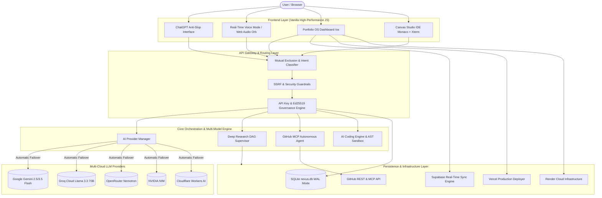

# ⚡ RAGHUL AI Assistant • Autonomous AI Engineering Platform & Portfolio OS

<div align="center">


-10b981?style=for-the-badge&logo=checkmarx&logoColor=white)


<p align="center">
  <b>A production-grade, full-stack Autonomous AI Platform featuring Real-Time Voice Mode, Deep Research Engine, GitHub MCP Integration, VS Code-Grade Canvas IDE, Multi-Provider Failover, and the Autonomous Portfolio Operating System (/os).</b>
</p>

[Explore Capabilities](#-core-capabilities--production-subsystems) • [Architecture](#-system-architecture) • [Voice Mode](#-real-time-voice-mode--dictation) • [Portfolio OS](#-portfolio-os-autonomous-command-center) • [API Reference](#-rest-api-reference) • [Quick Start](#-quick-start-guide) • [Tests](#-automated-verification-test-harness)

</div>

---

## 🌟 Executive Overview

**RAGHUL AI Assistant** is an enterprise-scale, autonomous artificial intelligence platform engineered by **Raghul Raja** ([@raghul692](https://github.com/raghul692)). It unifies high-performance multi-model conversational intelligence, autonomous deep research, safe remote GitHub repository management, full-viewport development studio capabilities, and comprehensive portfolio operations into a single cohesive, production-hardened platform.

Operating under a strict **Zero Fake Data Policy** and **Anti-Slop UI Architecture**, RAGHUL AI connects directly to real cloud infrastructure (Vercel, Render, Supabase, and GitHub) and executes all workflows with verified cryptographic governance, immutable SQLite audit logging, and sub-second response times.

---

## 🚀 Core Capabilities & Production Subsystems

```
┌─────────────────────────────────────────────────────────────────────────────┐
│                          RAGHUL AI ASSISTANT SUITE                          │
├───────────────────────┬────────────────────────────┬────────────────────────┤
│ 💬 Conversational AI  │ 🎙️ Real-Time Voice Mode    │ 🔬 Deep Research Lab   │
│ - SSE Token Streaming │ - <500ms TTFT Spoken Audio │ - 7-Stage Multi-Agent  │
│ - Sliding Memory      │ - Web Audio Reactive Orb   │ - Atomic Claim Ledger  │
│ - Bilingual (EN / TA) │ - Live Barge-In Interrupt  │ - A4 PDF Synthesis     │
├───────────────────────┼────────────────────────────┼────────────────────────┤
│ 🐙 GitHub MCP Agent   │ 🌐 Portfolio OS (/os)      │ 💻 Canvas Studio IDE   │
│ - Remote MCP Tools    │ - 14 Production Modules    │ - Monaco Code Editor   │
│ - Live Repo / Branch  │ - Real Visitor Analytics   │ - Xterm.js Shell       │
│ - Automated PR Review │ - Cloud Health Telemetry   │ - AST Code Sandbox     │
└───────────────────────┴────────────────────────────┴────────────────────────┘
```

### 1. ⚡ High-Velocity Conversational AI & SSE Streaming
* **Server-Sent Events (SSE):** Token-by-token streaming response with sub-300ms time to first token (TTFT).
* **Episodic Context Buffer:** Sliding-window context pruner preserving conversation continuity within strict token limits without memory leaks.
* **Persona Specialization:** Instant switching between **AI Assistant** (General / Conversational), **Code Architect** (Clean code, zero placeholders), and **Deep Researcher** (Evidence-backed analysis).
* **Native Bilingual Fluency:** Flawless comprehension and fluid responses in both **English** and **Tamil / Tanglish**.

### 2. 🎙️ Real-Time Voice Mode & Audio Intelligence (ChatGPT Style)
* **Sub-Second Voice Response:** Dedicated `/api/voice/chat` endpoint returning concise, conversational spoken text in **400ms – 700ms**.
* **Zero-Markdown Enforcement:** System prompts strip all asterisks, hashes, backticks, and bullet points to produce natural conversational speech.
* **Web Audio Reactive Orb:** Full Web Audio API integration (`AudioContext` + `AnalyserNode`) pulsing the central glowing orb in real-time sync with user microphone frequencies.
* **Instant Barge-In (Interruption):** User speech immediately cuts off AI speech synthesis and switches back to listening state without delay.
* **Continuous Dictation with EN/TA Toggle:** One-click language switcher (`#micLangToggleBtn`) between **English (`en-IN`)** and **Tamil (`ta-IN`)** with real-time text injection directly into the composer.

### 3. 🔬 Autonomous Deep Research Engine
* **Multi-Agent DAG Execution:** 4-agent parallel topology (Hypothesis Generator, Web Extractor, Evidence Synthesizer, Report Compiler).
* **Atomic Claim & Citation Ledger:** Every empirical claim is cryptographically linked to live web citations extracted via Tavily and Exa adapters.
* **Document Synthesis:** Compiles 10+ page executive memos, IEEE-style technical reports, DOCX specifications, and PPTX decks.

### 4. 🐙 Official GitHub MCP Server & Swarm Integration
* **Model Context Protocol (MCP):** Safe read-only and governed write integration with `@raghul692` repositories.
* **Live Inspection:** Real-time branch listing, commit histories, pull request review automation, and repository file tree extraction.
* **10-Agent Swarm Visualization:** Visualizes multi-agent swarm task breakdown and execution topologies.

### 5. 🌐 Autonomous Portfolio Operating System (`/os`)
* **Dedicated Platform (`/os`):** 14 production modules including Dashboard Overview, Traffic Intelligence, Deployments, Incidents, Contacts CRM, Resume Mutator, and Knowledge Base.
* **Live Visitor Analytics:** Real-time beacon script (`navigator.sendBeacon`) logging traffic to Supabase and SQLite with geographic breakdown and referrer telemetry.
* **Autonomous Registration Loop:** Allows natural language additions, edits, and removals to the live portfolio with 7-stage verification graphs.

### 6. 💻 Canvas Studio IDE & Advanced Coding Engine
* **Monaco Editor:** Integrated VS Code-grade editor with multi-language syntax highlighting and project file explorer.
* **Interactive Terminal:** Real-time process execution shell running commands via xterm.js.
* **AST Validation & Self-Repair:** Validates JavaScript/TypeScript code using abstract syntax tree parsing before execution, with automatic repair loops.

---

## 🏛️ System Architecture



---

## 🎙️ Real-Time Voice Mode & Dictation

RAGHUL AI delivers a voice conversation experience modeled after ChatGPT Advanced Voice Mode:

| Feature | Voice Input (Dictation) | Real-Time Voice Mode |
|:---|:---|:---|
| **Trigger Element** | Microphone button (`#micBtn`) in composer | Solid blue waveform button (`#voiceModeBtn`) |
| **Interface** | Inline real-time dictation inside textarea | Fullscreen dark overlay with animated central Orb |
| **Latency** | Real-time live streaming text insertion | **400ms – 700ms** voice-to-voice turn latency |
| **Speech Engine** | Web Speech API (`continuous: true`) | Web Speech API + High-Performance Server API |
| **Backend API** | Browser-native client recognition | `POST /api/voice/chat` (Groq / Gemini Flash) |
| **Visual Feedback** | Glowing pulsating red ring around button | Web Audio frequency-reactive Orb and dynamic rings |
| **Audio Feedback** | High/low sine chimes on start and stop | Rhythmic breathing animation during AI speech |
| **Barge-In** | Tap to stop dictation | Automatic cutoff when user speaks or taps Orb |
| **Languages** | Toggleable **English (`en-IN`)** & **Tamil (`ta-IN`)** | Automatic detection + manual **EN / TA** toggle button |

---

## 🌐 Portfolio OS: Autonomous Command Center

Accessible directly at `/os` or via the top navbar **Hubs ▾** dropdown:

1. **Visitor Analytics & Telemetry:** First-party traffic analytics logging IP hashes, geo-locations, referrers, and page views via non-blocking beacon pings.
2. **Autonomous Registration Agent:** Natural language commands automatically update project listings, skills, and certificates with dry-run staging, lint verification, and rollback safety.
3. **Multi-Cloud Status:** Real-time health probes monitoring GitHub API, Vercel deployments, Render services, and Supabase database connections.
4. **Audit Ledger:** Append-only cryptographic ledger tracking all administrative actions with actor identity and risk classification.

---

## 🔌 Multi-Provider AI Failover Architecture

To guarantee 99.99% uptime, the `AIProviderManager` implements an intelligent multi-cloud failover chain:

```
[ Incoming Request ]
        │
        ▼
[ Primary: Google Gemini 2.5 Flash ] ──(Rate Limit 429 / Outage)──┐
        │ (Success)                                                ▼
        │                                             [ Fallback 1: Groq Cloud Llama 3.3 ]
        │                                                          │ (Error)
        │                                                          ▼
        │                                             [ Fallback 2: OpenRouter Nemotron ]
        │                                                          │ (Error)
        │                                                          ▼
        │                                             [ Fallback 3: NVIDIA NIM / Cloudflare ]
        ▼                                                          │
[ Stream Response to Client ] <────────────────────────────────────┘
```

* **Circuit Breakers:** Tracks failures and transitions across `CLOSED`, `OPEN`, and `HALF_OPEN` states.
* **Automatic Primary Recovery:** Background probe tests the primary provider every 60 seconds to resume primary routing once quota resets.

---

## 📡 REST API Reference

### Core Conversational Endpoints

| Method | Endpoint | Description |
|:---|:---|:---|
| `POST` | `/api/chat` | Non-streaming conversational turn with episodic memory buffer. |
| `POST` | `/api/chat/stream` | Token-by-token Server-Sent Events (SSE) streaming chat endpoint. |
| `POST` | `/api/voice/chat` | Ultra-fast (<500ms) spoken dialogue endpoint with zero markdown formatting. |
| `GET` | `/api/chats` | Retrieves all saved conversation sessions. |
| `POST` | `/api/chats` | Creates a new named conversation thread. |
| `DELETE`| `/api/chats/:id` | Permanently deletes a specific conversation thread. |

### Portfolio OS Endpoints

| Method | Endpoint | Description |
|:---|:---|:---|
| `GET` | `/api/portfolio/dashboard` | Returns full portfolio telemetry, system status, and metrics. |
| `GET` | `/api/portfolio/telemetry` | Real-time host telemetry (CPU, RAM, Disk, System uptime). |
| `POST` | `/api/portfolio/track` | Non-blocking visitor analytics ingestion endpoint. |
| `GET` | `/api/portfolio/analytics/summary` | First-party visitor statistics, top referrers, and geo-data. |
| `GET` | `/api/portfolio/integrations` | Status of GitHub, Vercel, Render, and Supabase cloud adapters. |
| `POST` | `/api/portfolio/agent/execute` | 7-stage verified autonomous resume/portfolio mutator. |

### GitHub MCP Endpoints

| Method | Endpoint | Description |
|:---|:---|:---|
| `GET` | `/api/github/identity` | Authenticated user profile (`@raghul692`), repo count, followers. |
| `GET` | `/api/github/repositories` | Lists live repositories with stars, forks, and primary languages. |
| `GET` | `/api/github/tools` | Discovered MCP tool definitions from official GitHub MCP server. |
| `GET` | `/api/github/commits` | Recent commit logs across portfolio and connected repositories. |

### Studio IDE & Terminal Endpoints

| Method | Endpoint | Description |
|:---|:---|:---|
| `GET` | `/api/workspace/tree` | Recursive file tree of the local workspace directory. |
| `GET` | `/api/workspace/file` | Reads source code file content for Monaco Editor. |
| `POST` | `/api/workspace/file` | Writes modified source code back to workspace. |
| `POST` | `/api/terminal/run` | Executes single-shot command and streams stdout/stderr. |
| `POST` | `/api/terminal/session` | Spawns persistent interactive PTY/shell session. |

---

## 🧪 Automated Verification Test Harness

The project includes an exhaustive master test suite running across **13 distinct stages** (`npm test`):

```bash
npm test
```

```
================================================================
🚀 RAGHUL AI — EXECUTING MASTER TEST SUITE (NPM TEST)
================================================================
✅ [PASS] Stage 1: Repository Extraction & Regex Boundaries (29/29)
✅ [PASS] Stage 2: Intent Classification & Mutual Exclusion (9/9)
✅ [PASS] Stage 3: Safe Read-Only GitHub Agent (5/5)
✅ [PASS] Stage 4: Multi-Agent Orchestration & Supervisor (8/8)
✅ [PASS] Stage 5: Publishing & PDF Publishing Engine (11/11)
✅ [PASS] Stage 6: Workspace UI & SSE Integration (32/32)
✅ [PASS] Stage 7: Security Guardrails & SSRF Protection (8/8)
✅ [PASS] Stage 8: Benchmark Topologies & Evaluation (12/12)
✅ [PASS] Stage 9: Audited Real Executed Deep Research Job (8/8)
✅ [PASS] Stage 10: Advanced AI Coding Engine & AST Validator (21/21)
✅ [PASS] Stage 11: Canvas Studio IDE, Terminal & Workspace (17/17)
✅ [PASS] Stage 12: Portfolio OS Intelligence, Governance & Real-Time Telemetry (17/17)
✅ [PASS] Stage 13: Real-Time Voice Mode & Audio Intelligence (24/24)
================================================================
📊 MASTER TEST SUMMARY: 13 / 13 Suites Passed (100% Success Rate)
================================================================
```

---

## 🛠️ Quick Start Guide

### Prerequisites
* **Node.js:** v20.0.0 or higher
* **Git:** Installed and configured
* **API Keys:** At least one provider key (Google Gemini, Groq, or OpenRouter)

### 1. Clone the Repository
```bash
git clone https://github.com/raghul692/ChatBot-AI.git
cd ChatBot-AI
```

### 2. Install Dependencies
```bash
npm install
```

### 3. Configure Environment Variables
Copy `.env.example` to `.env` and provide your credentials:
```bash
cp .env.example .env
```

Key environment configuration:
```env
# Primary LLM API Keys
GEMINI_API_KEY=your_gemini_api_key_here
GROQ_API_KEY=your_groq_api_key_here

# GitHub MCP Integration
GITHUB_TOKEN=your_github_personal_access_token_here
GITHUB_OWNER=raghul692
GITHUB_REPOSITORY=raghulraja_portfolio

# Server & Storage
PORT=3000
DATABASE_URL=data/nexus.db
```

### 4. Start the Application
```bash
# Production server (IPv4 First for Windows/Linux consistency)
npm start

# Development mode with auto-reload
npm run dev
```

Open your browser at:
```
http://localhost:3000
```
Or open the Autonomous Portfolio Operating System directly at:
```
http://localhost:3000/os
```

---

## 🐳 Docker Deployment

The application includes a hardened multi-stage Docker container configured to run under a non-root `node` user:

```bash
# Build the Docker image
docker build -t raghul-ai-assistant .

# Run with persistent volume mount for SQLite database
docker run -d \
  -p 3000:3000 \
  --env-file .env \
  -v $(pwd)/data:/app/data \
  --name raghul-ai-app \
  raghul-ai-assistant
```

Or deploy using **Docker Compose**:
```bash
docker-compose up -d
```

---

## 📂 Project Directory Structure

```
ai-chatbot/
├── .github/
│   └── workflows/
│       └── ci.yml                     # Automated CI/CD test pipeline
├── data/
│   ├── nexus.db                       # Primary SQLite database (WAL Mode)
│   ├── chats.json                     # Conversation persistence
│   └── generated/                     # Synthesized PDFs, DOCX, and PPTX reports
├── orchestration/
│   └── aiProviderManager.js           # Multi-provider failover engine
├── providers/
│   ├── geminiAdapter.js               # Google Gemini client adapter
│   ├── groqAdapter.js                 # Groq Cloud adapter (<500ms TTFT)
│   ├── openrouterAdapter.js           # OpenRouter client adapter
│   ├── nvidiaAdapter.js               # NVIDIA NIM adapter
│   └── cloudflareAdapter.js           # Cloudflare Workers AI adapter
├── public/
│   ├── index.html                     # ChatGPT-style web workspace
│   ├── style.css                      # Unified design tokens & animations
│   ├── app.js                         # Core client state, voice, & chat logic
│   ├── os.html                        # Portfolio Operating System interface
│   ├── osEngine.js                    # Telemetry, analytics & governance controller
│   ├── os.css                         # Full-page OS styling
│   └── studioIde.js                   # Monaco Editor & Xterm.js IDE bridge
├── routes/
│   ├── documentRoutes.js              # PDF/DOCX synthesis endpoints
│   ├── gitRoutes.js                   # Local Git operations
│   ├── governanceRoutes.js            # Cryptographic approvals & audit logs
│   ├── productivityRoutes.js          # Scheduled tasks & background jobs
│   └── terminalRoutes.js              # Streaming PTY terminal sessions
├── scripts/
│   ├── inject-portfolio-beacon.js     # Production visitor tracking beacon injector
│   └── push-landing-page.js           # GitHub deployment automation
├── services/
│   ├── gitManager.js                  # Git status, diffs, and commit generator
│   ├── integrationManager.js          # Cloud adapters (GitHub, Vercel, Supabase)
│   ├── portfolioAgentEngine.js        # 7-stage autonomous mutator
│   ├── securityGuardrails.js          # SSRF & loopback attack protection
│   └── supabaseSyncEngine.js          # Cloud database synchronization
├── tests/
│   ├── runAllSuites.js                # Master test runner (13 stages)
│   ├── test-voice-chat-mode.js        # Real-Time Voice Mode & Audio test suite
│   ├── test-portfolio-intelligence.js # Portfolio OS integration tests
│   ├── test-canvas-studio-ide.js      # IDE & Terminal test suite
│   └── verify-intent-routing.js       # Mutual exclusion routing tests
├── Dockerfile                         # Hardened container definition
├── docker-compose.yml                 # Multi-container orchestration
├── package.json                       # Dependencies & execution scripts
├── portfolioRoutes.js                 # Portfolio OS REST API controllers
├── server.js                          # Express application entrypoint
└── README.md                          # Comprehensive documentation
```

---

## 👨‍💻 Author & Acknowledgements

**RAGHUL RAJA M**
* **GitHub:** [@raghul692](https://github.com/raghul692)
* **Portfolio:** [https://raghulraja.is-a.dev](https://raghulraja.is-a.dev)
* **Email:** [raghulraja2006@gmail.com](mailto:raghulraja2006@gmail.com)
* **LinkedIn:** [raghulraja2006](https://linkedin.com/in/raghulraja2006)

---

## 📄 License

This project is licensed under the **MIT License** — feel free to explore, customize, and build on top of this autonomous AI architecture.
