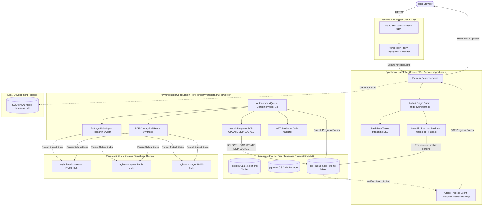

# ⚡ RAGHUL AI Assistant • Autonomous AI Engineering Platform & Portfolio OS

<div align="center">


-10b981?style=for-the-badge&logo=checkmarx&logoColor=white)
-10b981?style=for-the-badge&logo=githubactions&logoColor=white)


<p align="center">
  <b>A production-grade, horizontally scalable, multi-tier Autonomous AI Platform featuring Real-Time Voice Mode, Deep Research Engine, Distributed Background Workers, Supabase PostgreSQL with pgvector, Cloud Object Storage, and the Autonomous Portfolio Operating System (/os).</b>
</p>

[Architecture](#-production-system-topology) • [Deployment Guides](#-comprehensive-production-guides) • [Voice Mode](#-real-time-voice-mode--dictation) • [Portfolio OS](#-portfolio-os-autonomous-command-center) • [API Reference](#-rest-api-reference) • [Quick Start](#-quick-start-guide) • [Verification Tests](#-automated-verification-test-harness)

</div>

---

## 🌟 Executive Overview

**RAGHUL AI Assistant** is an enterprise-scale, autonomous artificial intelligence platform engineered by **Raghul Raja** ([@raghul692](https://github.com/raghul692)). It unifies high-performance multi-model conversational intelligence, autonomous deep research, safe remote GitHub repository management, full-viewport development studio capabilities, and comprehensive portfolio operations into a single cohesive, production-hardened platform.

Operating under a strict **Zero Fake Data Policy** and **Anti-Slop UI Architecture**, RAGHUL AI is structured across a production-grade decoupled topology:
- **Frontend:** Vercel Global Edge Network (Static Single Page Application & Asset Delivery).
- **Backend API:** Render Web Service (`raghul-ai-api`) for low-latency REST, SSE, and synchronous orchestration.
- **Background Worker:** Render Background Worker (`raghul-ai-worker`) consuming distributed tasks via PostgreSQL `FOR UPDATE SKIP LOCKED`.
- **Database & Vector Store:** Supabase Cloud PostgreSQL 17.6 with `pgvector` extension for semantic embeddings and knowledge search.
- **Cloud Object Storage:** Supabase Storage (`raghul-ai-documents`, `raghul-ai-reports`, `raghul-ai-images`) eliminating local filesystem dependencies.
- **Dual-Adapter Persistence:** Transparent routing to Supabase in production with automatic fallback to local SQLite (`data/nexus.db`) for offline development.

---

## 📚 Comprehensive Production Guides

The repository includes complete production operational runbooks:

1. [ARCHITECTURE.md](ARCHITECTURE.md) — Comprehensive multi-tier system topology, data flows, and concurrency models.
2. [DEPLOYMENT.md](DEPLOYMENT.md) — Step-by-step production deployment guide for Vercel, Render, and Supabase.
3. [DATABASE_MIGRATION.md](DATABASE_MIGRATION.md) — SQLite to PostgreSQL schema migration, type mappings, and verification report.
4. [WORKER_GUIDE.md](WORKER_GUIDE.md) — Render Background Worker operations, distributed queue, priority, and DLQ runbook.
5. [STORAGE_GUIDE.md](STORAGE_GUIDE.md) — Supabase Storage configuration, bucket policies, RLS, and signed URLs.
6. [SECURITY.md](SECURITY.md) — Zero-trust security posture, CORS allowlist, request tracing, and SSRF guardrails.
7. [ENVIRONMENT_VARIABLES.md](ENVIRONMENT_VARIABLES.md) — Master environment variables reference across all platforms.
8. [PRODUCTION_CHECKLIST.md](PRODUCTION_CHECKLIST.md) — Pre-flight readiness gates and verification checklist.
9. [ROLLBACK_PLAN.md](ROLLBACK_PLAN.md) — Rapid disaster recovery, schema rollback, and dual-adapter fallback runbook.

---

## 🏛️ Production System Topology



---

## 🚀 Core Capabilities & Production Subsystems

```
┌─────────────────────────────────────────────────────────────────────────────┐
│                          RAGHUL AI ASSISTANT SUITE                          │
├───────────────────────┬────────────────────────────┬────────────────────────┤
│ 💬 Conversational AI  │ 🎙️ Real-Time Voice Mode    │ 🔬 Deep Research Lab   │
│ - SSE Token Streaming │ - <500ms TTFT Spoken Audio │ - 7-Stage Multi-Agent  │
│ - Sliding Memory      │ - Web Audio Reactive Orb   │ - Atomic Claim Ledger  │
│ - Bilingual (EN / TA) │ - Live Barge-In Interrupt  │ - A4 PDF Synthesis     │
├───────────────────────┼────────────────────────────┼────────────────────────┤
│ 🐙 GitHub MCP Agent   │ 🌐 Portfolio OS (/os)      │ 💻 Canvas Studio IDE   │
│ - Remote MCP Tools    │ - 14 Production Modules    │ - Monaco Code Editor   │
│ - Live Repo / Branch  │ - Real Visitor Analytics   │ - Xterm.js Shell       │
│ - Automated PR Review │ - Cloud Health Telemetry   │ - AST Code Sandbox     │
├───────────────────────┼────────────────────────────┼────────────────────────┤
│ 📦 Distributed Worker │ 🗄️ Cloud Object Storage    │ 🛡️ Zero-Trust Security  │
│ - Render Daemon       │ - Supabase Storage Buckets │ - Request ID Tracing   │
│ - SKIP LOCKED Queue   │ - Signed URL Expirations   │ - Strict Origin CORS   │
│ - Exponential Backoff │ - Zero Ephemeral Disk Loss │ - Developer API Keys   │
└───────────────────────┴────────────────────────────┴────────────────────────┘
```

---

## 🎙️ Real-Time Voice Mode & Dictation

RAGHUL AI delivers a voice conversation experience modeled after ChatGPT Advanced Voice Mode:

| Feature | Voice Input (Dictation) | Real-Time Voice Mode |
|:---|:---|:---|
| **Trigger Element** | Microphone button (`#micBtn`) in composer | Solid blue waveform button (`#voiceModeBtn`) |
| **Interface** | Inline real-time dictation inside textarea | Fullscreen dark overlay with animated central Orb |
| **Latency** | Real-time live streaming text insertion | **400ms – 700ms** voice-to-voice turn latency |
| **Speech Engine** | Web Speech API (`continuous: true`) | Web Speech API + High-Performance Server API |
| **Backend API** | Browser-native client recognition | `POST /api/voice/chat` (Groq / Gemini Flash) |
| **Visual Feedback** | Glowing pulsating red ring around button | Web Audio frequency-reactive Orb and dynamic rings |
| **Barge-In** | Tap to stop dictation | Automatic cutoff when user speaks or taps Orb |
| **Languages** | Toggleable **English (`en-IN`)** & **Tamil (`ta-IN`)** | Automatic detection + manual **EN / TA** toggle button |

---

## 🌐 Portfolio OS: Autonomous Command Center

Accessible directly at `/os` or via the top navbar **Hubs ▾** dropdown:

1. **Visitor Analytics & Telemetry:** First-party traffic analytics logging IP hashes, geo-locations, referrers, and page views via non-blocking beacon pings.
2. **Autonomous Registration Agent:** Natural language commands automatically update project listings, skills, and certificates with dry-run staging, lint verification, and rollback safety.
3. **Multi-Cloud Status:** Real-time health probes monitoring GitHub API, Vercel deployments, Render services, and Supabase database connections.
4. **Audit Ledger:** Append-only cryptographic ledger tracking all administrative actions with actor identity and risk classification.

---

## 📡 REST API Reference

### Core Endpoints

| Method | Endpoint | Description |
|:---|:---|:---|
| `GET` | `/health` | Production liveness probe returning uptime, memory, and service status. |
| `GET` | `/ready` | Production readiness probe verifying database connectivity and queue health. |
| `POST` | `/api/chat` | Non-streaming conversational turn with episodic memory buffer. |
| `POST` | `/api/chat/stream` | Token-by-token Server-Sent Events (SSE) streaming chat endpoint. |
| `POST` | `/api/voice/chat` | Ultra-fast (<500ms) spoken dialogue endpoint with zero markdown formatting. |

### Distributed Job Queue & Real-Time SSE Endpoints

| Method | Endpoint | Description |
|:---|:---|:---|
| `POST` | `/api/jobs` | Enqueues background job (`deep_research`, `document_generation`, etc.). |
| `GET` | `/api/jobs/:id` | Polls current status, progress, execution duration, and output artifact. |
| `GET` | `/api/jobs/:id/stream`| Authenticated SSE stream receiving real-time worker progress events. |

### Portfolio OS & Management Endpoints

| Method | Endpoint | Description |
|:---|:---|:---|
| `GET` | `/api/portfolio/dashboard` | Returns full portfolio telemetry, system status, and metrics. |
| `POST` | `/api/portfolio/track` | Non-blocking visitor analytics ingestion endpoint. |
| `GET` | `/api/portfolio/integrations` | Status of GitHub, Vercel, Render, and Supabase cloud adapters. |
| `POST` | `/api/portfolio/agent/execute` | 7-stage verified autonomous resume/portfolio mutator. |

---

## 🧪 Automated Verification Test Harness

The project includes two exhaustive automated test suites:

### 1. Master Baseline Regression Suite (`npm test`)
Executes all 14 baseline test stages:
```bash
npm test
```
```
================================================================
📊 MASTER TEST SUMMARY: 14 / 14 Suites Passed (227.2s)
================================================================
✅ [PASS] Repository Extraction & Regex Boundaries
✅ [PASS] Intent Classification & Mutual Exclusion
✅ [PASS] Safe Read-Only GitHub Agent
✅ [PASS] Stage 4: Multi-Agent Orchestration & Supervisor
✅ [PASS] Stage 5: Publishing & PDF Publishing Engine
✅ [PASS] Stage 6: Workspace UI & SSE Integration
✅ [PASS] Stage 7: Security Guardrails & SSRF Protection
✅ [PASS] Stage 8: Benchmark Topologies & Evaluation
✅ [PASS] Audited Real Executed Deep Research Job
✅ [PASS] Stage 10: Advanced AI Coding Engine & AST Validator
✅ [PASS] Stage 11: Canvas Studio IDE, Terminal & Workspace
✅ [PASS] Stage 12: Portfolio OS Intelligence, Governance & Real-Time Telemetry
✅ [PASS] Stage 13: Real-Time Voice Mode & Audio Intelligence
✅ [PASS] Stage 14: Conversational Memory, Context Awareness & History Recall
🎉 All test suites passed with 100% success rate.
```

### 2. Production Architecture Verification Suite
Executes the 6 cloud-native architecture test suites:
```bash
node tests/runProductionSuites.js
```
```
================================================================
PRODUCTION SUITE SUMMARY: 6 Passed, 0 Failed
================================================================
✅ [PASS] tests/test-production-db-adapter.js (Liveness, queries, parameters, transactions)
✅ [PASS] tests/test-production-queue-worker.js (Atomic dequeue, idempotency, retry, DLQ)
✅ [PASS] tests/test-production-storage.js (Buffer upload, download, signed URL, deletion)
✅ [PASS] tests/test-production-health-ready.js (Liveness, readiness, CORS headers, Jobs API)
✅ [PASS] tests/test-production-sse-realtime.js (Cross-process SSE broadcast, disconnect cleanup)
✅ [PASS] tests/test-production-simulation-e2e.js (Multi-process Web + Worker orchestration)
```

---

## 🛠️ Quick Start & Local Execution

### 1. Clone & Install
```bash
git clone https://github.com/raghul692/ChatBot-AI.git
cd ChatBot-AI
npm install
```

### 2. Configure Environment
```bash
cp .env.example .env
```

### 3. Apply Database Migrations (Supabase or Local)
```bash
# Apply schema migrations
npm run migrate

# Migrate SQLite records to Supabase (optional)
npm run migrate:data
```

### 4. Run Locally
```bash
# Run Web Service
npm start

# In a separate terminal, run Background Worker
npm run worker
```

Open `http://localhost:3000` to interact with the platform, or `http://localhost:3000/os` for Portfolio OS.

---

## 👨‍💻 Author & Acknowledgements

**RAGHUL RAJA M**
* **GitHub:** [@raghul692](https://github.com/raghul692)
* **Portfolio:** [https://raghulraja.is-a.dev](https://raghulraja.is-a.dev)
* **Email:** [raghulraja2006@gmail.com](mailto:raghulraja2006@gmail.com)
* **LinkedIn:** [raghulraja2006](https://linkedin.com/in/raghulraja2006)

---

## 📄 License

This project is licensed under the **MIT License** — feel free to explore, customize, and build on top of this autonomous AI architecture.
