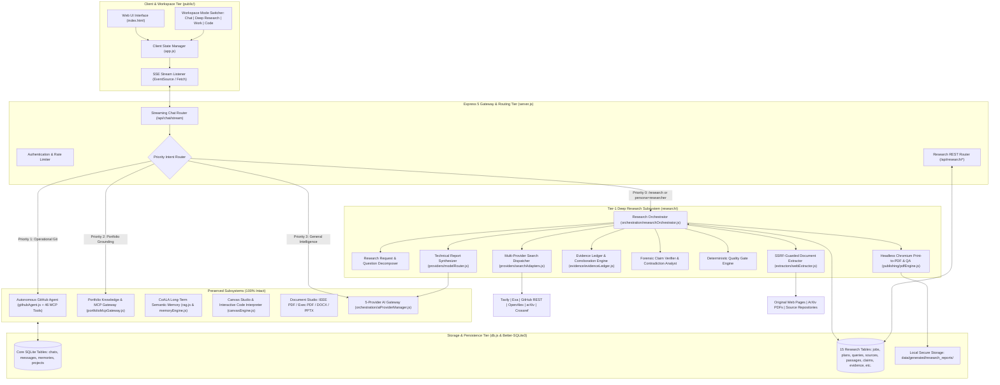
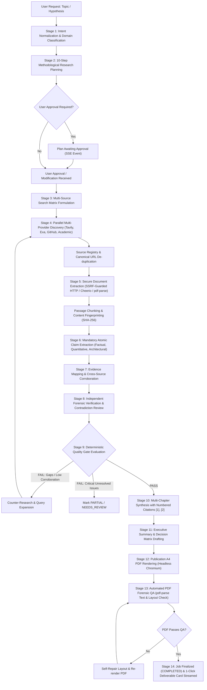
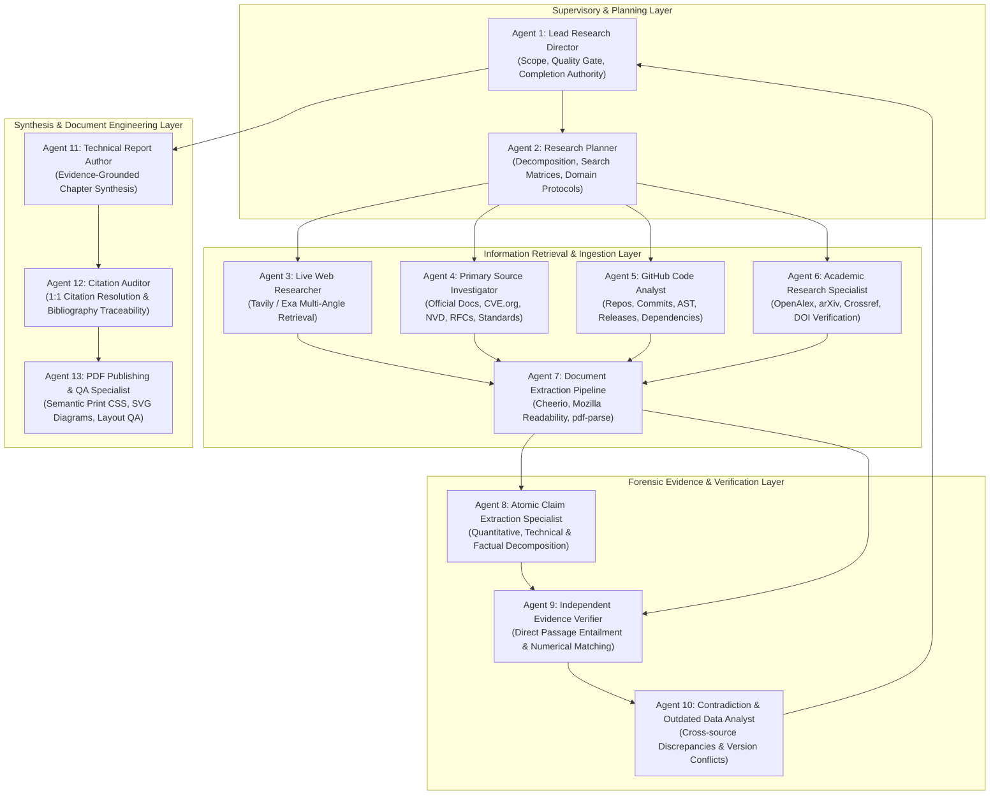
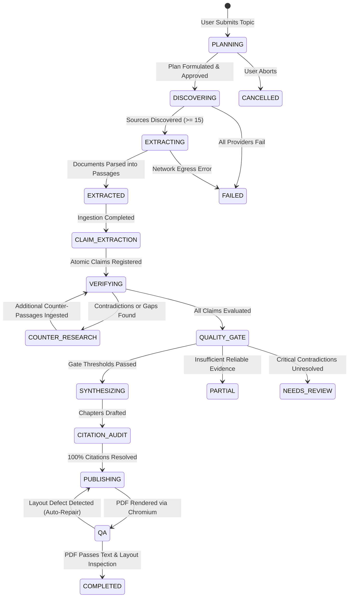
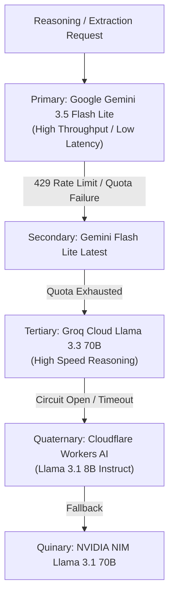
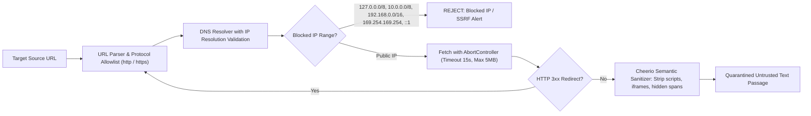
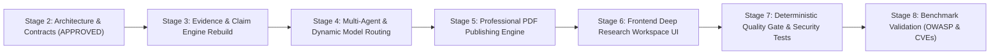

# RAGHUL AI — TIER-1 AUTONOMOUS DEEP RESEARCH ENGINE
## STAGE 2: MASTER ARCHITECTURAL SPECIFICATION, DATA CONTRACTS & QUALITY GATES

**Document Version:** 2.0.0-PROD-SPEC  
**Status:** COMPLETE — AWAITING STAGE 3 APPROVAL  
**Branch:** `feature/tier1-deep-research-engine`  
**Baseline Git Commit:** `2470485` (chore: baseline snapshot before Stage 2 Deep Research architecture)  
**Security Classification:** Restricted / System Internal Architecture  
**Author:** Principal AI Systems Architect & Research Engineering Team  

---

## 1. Updated Repository Architecture Diagram



---

## 2. Complete Target Research Data-Flow Diagram



---

## 3. Agent Orchestration and Responsibility Diagram



---

## 4. Existing Dependency & Subsystem Map

The following table documents all existing production systems and certifies their non-destructive preservation:

| Subsystem Name | Key Implementation Files | State & Storage | External Integration | Preservation Guarantee |
| :--- | :--- | :--- | :--- | :--- |
| **Conversational Chat** | `server.js`, `public/app.js` | SQLite: `chats`, `messages` | Gemini / Groq / Cloudflare | 100% Preserved; SSE protocol unchanged. |
| **5-Provider Gateway** | `orchestration/aiProviderManager.js` | In-memory health circuits | Google GenAI, Groq SDK, NVIDIA, Cloudflare, OpenRouter | 100% Preserved; multi-model fallback intact. |
| **CoALA Semantic Memory** | `rag.js`, `memoryEngine.js` | SQLite: `memories`, TF-IDF index | In-memory vector store & BM25 | 100% Preserved; fact extraction untouched. |
| **Autonomous GitHub Agent** | `githubAgent.js`, `githubMcpGateway.js` | SQLite: `github_audit_ledger` | 46 Official GitHub MCP Tools | 100% Preserved; routing priority fixed so `/research` is never stolen. |
| **Portfolio Intelligence** | `portfolioKnowledgeEngine.js`, `portfolioMcpGateway.js` | In-memory knowledge cache | Live site `raghulraja.is-a.dev` | 100% Preserved; portfolio grounding intact. |
| **Canvas Studio** | `canvasEngine.js`, `terminalSandbox.js` | File storage in `scratch/` | Node vm / sandbox | 100% Preserved; multi-file tabs intact. |
| **Document Studio** | `documentEngine.js` | `data/generated/documents/` | `pdf-lib`, `docx`, `pptxgenjs` | 100% Preserved; standalone converters intact. |
| **Security & Sanitization** | `security.js`, `governanceAudit.js` | Hash-chained audit ledger | Internal regex & sanitizers | 100% Preserved; injection guards active. |

---

## 5. Full SQLite Schema Specification (15 Entities)

All tables are placed in `data/nexus.db` with additive migrations. Every entity is specified below:

### 1. `research_jobs`
Master record tracking research state machine, budget, token counts, and completion metrics.
- `id` (TEXT, PK): Unique research job ID (e.g. `rjob_1794154129600_4e1e0z`).
- `session_id` (TEXT, Nullable): Foreign reference to active user chat session.
- `user_query` (TEXT, NOT NULL): Raw user prompt.
- `domain` (TEXT, NOT NULL DEFAULT 'general'): Classification (`ai`, `cybersecurity`, `software`, `academic`, `market`, etc.).
- `mode` (TEXT, NOT NULL DEFAULT 'deep'): Execution depth (`quick`, `deep`, `exhaustive`).
- `status` (TEXT, NOT NULL DEFAULT 'PLANNING'): State enum (see Section 9).
- `require_approval` (INTEGER, NOT NULL DEFAULT 1): Flag (0 or 1) requiring human sign-off on research plan.
- `approved_at` (INTEGER, Nullable): Unix timestamp of plan approval.
- `current_stage` (TEXT, NOT NULL DEFAULT 'PLANNING'): Current state machine stage.
- `progress` (INTEGER, NOT NULL DEFAULT 0): Percentage (0 to 100).
- `budget_usd` (REAL, NOT NULL DEFAULT 2.00): Configured financial ceiling.
- `spent_usd` (REAL, NOT NULL DEFAULT 0.00): Estimated accrued cost.
- `total_tokens` (INTEGER, NOT NULL DEFAULT 0): Cumulative prompt + completion tokens.
- `sources_count` (INTEGER, NOT NULL DEFAULT 0): Count of registered unique sources.
- `passages_count` (INTEGER, NOT NULL DEFAULT 0): Count of extracted evidence passages.
- `claims_count` (INTEGER, NOT NULL DEFAULT 0): Count of extracted atomic claims.
- `verified_claims_count` (INTEGER, NOT NULL DEFAULT 0): Count of verified/corroborated claims.
- `contradictions_count` (INTEGER, NOT NULL DEFAULT 0): Count of identified conflicting facts.
- `quality_gate_passed` (INTEGER, NOT NULL DEFAULT 0): Boolean (0 or 1).
- `quality_gate_score` (REAL, Nullable): Composite quality score (0.00 to 1.00).
- `error_message` (TEXT, Nullable): Failure reason if status is FAILED or BLOCKED.
- `created_at` (INTEGER, NOT NULL): Creation Unix timestamp.
- `updated_at` (INTEGER, NOT NULL): Last update Unix timestamp.
- `completed_at` (INTEGER, Nullable): Completion Unix timestamp.
- **Indexes:** `idx_research_jobs_status` ON `research_jobs(status)`, `idx_research_jobs_created` ON `research_jobs(created_at DESC)`.

### 2. `research_plans`
Structured methodology, research questions, and search strategy.
- `id` (TEXT, PK): `rplan_<timestamp>_<hex>`.
- `job_id` (TEXT, NOT NULL, FK -> `research_jobs(id)` ON DELETE CASCADE).
- `title` (TEXT, NOT NULL): Investigation title.
- `domain` (TEXT, NOT NULL): Domain identifier.
- `time_sensitivity` (TEXT, NOT NULL DEFAULT 'current'): Scope (`current`, `historical`, `forward_looking`).
- `target_entities` (TEXT, NOT NULL): JSON array of primary organizations, CVEs, or technologies.
- `constraints` (TEXT, NOT NULL): JSON array of research limits and exclusions.
- `subtopics` (TEXT, NOT NULL): JSON array of chapter breakdown objects.
- `primary_questions` (TEXT, NOT NULL): JSON array of hypotheses to resolve.
- `search_strategy` (TEXT, NOT NULL): JSON object detailing provider weighting.
- `approved` (INTEGER, NOT NULL DEFAULT 0): Boolean.
- `user_feedback` (TEXT, Nullable): User modification prompt if adjusted.
- `created_at` (INTEGER, NOT NULL).
- `updated_at` (INTEGER, NOT NULL).
- **Indexes:** `idx_research_plans_job` ON `research_plans(job_id)`.

### 3. `research_queries`
Audit log of every query executed against external discovery adapters.
- `id` (TEXT, PK): `rqry_<timestamp>_<hex>`.
- `job_id` (TEXT, NOT NULL, FK -> `research_jobs(id)` ON DELETE CASCADE).
- `channel` (TEXT, NOT NULL): `tavily` | `exa` | `github` | `openalex` | `arxiv` | `crossref`.
- `subtopic` (TEXT, Nullable): Associated chapter title.
- `query` (TEXT, NOT NULL): Exact query string sent to API.
- `purpose` (TEXT, NOT NULL): `discovery` | `deepening` | `counter_research` | `fact_check`.
- `is_counter_research` (INTEGER, NOT NULL DEFAULT 0): 0 or 1.
- `status` (TEXT, NOT NULL DEFAULT 'PENDING'): `PENDING` | `COMPLETED` | `FAILED`.
- `result_count` (INTEGER, NOT NULL DEFAULT 0).
- `duration_ms` (INTEGER, Nullable).
- `created_at` (INTEGER, NOT NULL).
- **Indexes:** `idx_research_queries_job` ON `research_queries(job_id)`.

### 4. `research_sources`
Registry of all discovered sources with provenance and quality scoring.
- `id` (TEXT, PK): `src_<timestamp>_<hex>`.
- `job_id` (TEXT, NOT NULL, FK -> `research_jobs(id)` ON DELETE CASCADE).
- `url` (TEXT, NOT NULL): Original retrieval URL.
- `canonical_url` (TEXT, NOT NULL): Canonicalized, normalized URL.
- `domain` (TEXT, NOT NULL): Hostname (e.g. `nvd.nist.gov`).
- `title` (TEXT, Nullable): Page or paper title.
- `author` (TEXT, Nullable): Author or research entity.
- `publisher` (TEXT, Nullable): Publishing body or journal.
- `published_date` (TEXT, Nullable): Isolated ISO date or 'UNKNOWN' (no silent assumptions).
- `category` (TEXT, NOT NULL DEFAULT 'web'): `primary_doc` | `academic` | `github` | `news` | `web`.
- `authority_score` (REAL, NOT NULL DEFAULT 0.50): 0.00 to 1.00 based on domain trust.
- `freshness_score` (REAL, NOT NULL DEFAULT 0.50): Evaluated only if published_date is verified.
- `transparency_score` (REAL, NOT NULL DEFAULT 0.50): Methodology/citation clarity.
- `confidence_score` (REAL, NOT NULL DEFAULT 0.50): Weighted composite authority metric.
- `is_primary_source` (INTEGER, NOT NULL DEFAULT 0): Boolean.
- `created_at` (INTEGER, NOT NULL).
- **Unique Constraint:** `UNIQUE(job_id, canonical_url)`.
- **Indexes:** `idx_research_sources_job` ON `research_sources(job_id)`.

### 5. `source_passages` (formerly extracted_passages)
Normalized chunked passages extracted from source documents.
- `id` (TEXT, PK): `ev_<timestamp>_<hex>`.
- `job_id` (TEXT, NOT NULL, FK -> `research_jobs(id)` ON DELETE CASCADE).
- `source_id` (TEXT, NOT NULL, FK -> `research_sources(id)` ON DELETE CASCADE).
- `source_url` (TEXT, NOT NULL).
- `passage_index` (INTEGER, NOT NULL): Chunk order inside source.
- `section_heading` (TEXT, Nullable): Closest markdown heading `<h1>-<h3>`.
- `content` (TEXT, NOT NULL): Text content (100 to 2,000 characters).
- `content_hash` (TEXT, NOT NULL): SHA-256 fingerprint of content.
- `char_count` (INTEGER, NOT NULL).
- `created_at` (INTEGER, NOT NULL).
- **Indexes:** `idx_source_passages_job` ON `source_passages(job_id)`, `idx_source_passages_source` ON `source_passages(source_id)`.

### 6. `research_claims`
Atomic factual, quantitative, and architectural propositions extracted from evidence.
- `id` (TEXT, PK): `clm_<timestamp>_<hex>`.
- `job_id` (TEXT, NOT NULL, FK -> `research_jobs(id)` ON DELETE CASCADE).
- `primary_source_id` (TEXT, Nullable, FK -> `research_sources(id)`).
- `claim_text` (TEXT, NOT NULL): Discrete testable proposition.
- `claim_type` (TEXT, NOT NULL): `factual` | `quantitative` | `architectural` | `cve_exploit` | `comparative`.
- `exact_quote` (TEXT, Nullable): Direct verbatim citation excerpt from originating passage.
- `scope_temporal` (TEXT, Nullable): Relevant year or date range (e.g. `2026`, `2023-04`).
- `verification_status` (TEXT, NOT NULL DEFAULT 'UNVERIFIED'): `VERIFIED` | `PARTIALLY_SUPPORTED` | `CONTRADICTED` | `UNVERIFIED` | `DISPUTED` | `INFERENCE` | `OPINION`.
- `confidence_score` (REAL, NOT NULL DEFAULT 0.50): Post-verification confidence (0.00 to 1.00).
- `is_critical` (INTEGER, NOT NULL DEFAULT 0): Boolean indicating key benchmark fact.
- `verifier_agent` (TEXT, Nullable): Agent identifier that executed verification.
- `verification_notes` (TEXT, Nullable): Structured rationale or formula verification detail.
- `verified_at` (INTEGER, Nullable): Unix timestamp.
- `created_at` (INTEGER, NOT NULL).
- **Indexes:** `idx_research_claims_job` ON `research_claims(job_id)`, `idx_research_claims_status` ON `research_claims(verification_status)`.

### 7. `claim_evidence`
Junction table mapping claims to supporting or contradicting source passages.
- `id` (TEXT, PK): `clev_<timestamp>_<hex>`.
- `claim_id` (TEXT, NOT NULL, FK -> `research_claims(id)` ON DELETE CASCADE).
- `passage_id` (TEXT, NOT NULL, FK -> `source_passages(id)` ON DELETE CASCADE).
- `relationship` (TEXT, NOT NULL DEFAULT 'supports'): `supports` | `contradicts` | `context`.
- `support_strength` (REAL, NOT NULL DEFAULT 0.80): 0.00 to 1.00.
- `created_at` (INTEGER, NOT NULL).
- **Unique Constraint:** `UNIQUE(claim_id, passage_id, relationship)`.
- **Indexes:** `idx_claim_evidence_claim` ON `claim_evidence(claim_id)`, `idx_claim_evidence_passage` ON `claim_evidence(passage_id)`.

### 8. `research_contradictions`
Discrepancies identified across distinct sources (e.g. version ranges, benchmark latency).
- `id` (TEXT, PK): `cnt_<timestamp>_<hex>`.
- `job_id` (TEXT, NOT NULL, FK -> `research_jobs(id)` ON DELETE CASCADE).
- `claim_id` (TEXT, Nullable, FK -> `research_claims(id)`).
- `source_a_id` (TEXT, NOT NULL, FK -> `research_sources(id)`).
- `source_b_id` (TEXT, NOT NULL, FK -> `research_sources(id)`).
- `disputed_topic` (TEXT, NOT NULL): Short descriptor (e.g. 'CVE-2023-29374 Fixed Version').
- `source_a_assertion` (TEXT, NOT NULL).
- `source_b_assertion` (TEXT, NOT NULL).
- `resolution_strategy` (TEXT, NOT NULL): `primary_source_wins` | `disputed_in_report` | `time_decay`.
- `final_disposition` (TEXT, NOT NULL): Synthesis decision for report.
- `created_at` (INTEGER, NOT NULL).
- **Indexes:** `idx_research_contradictions_job` ON `research_contradictions(job_id)`.

### 9. `verification_runs`
Forensic verification audit session records.
- `id` (TEXT, PK): `vrun_<timestamp>_<hex>`.
- `job_id` (TEXT, NOT NULL, FK -> `research_jobs(id)` ON DELETE CASCADE).
- `verifier_model` (TEXT, NOT NULL): LLM or algorithmic validator model ID.
- `claims_inspected` (INTEGER, NOT NULL).
- `claims_verified` (INTEGER, NOT NULL).
- `claims_disputed` (INTEGER, NOT NULL).
- `claims_unverified` (INTEGER, NOT NULL).
- `duration_ms` (INTEGER, NOT NULL).
- `created_at` (INTEGER, NOT NULL).
- **Indexes:** `idx_verification_runs_job` ON `verification_runs(job_id)`.

### 10. `agent_executions`
Observable event log of every specialist agent activation.
- `id` (TEXT, PK): `aexec_<timestamp>_<hex>`.
- `job_id` (TEXT, NOT NULL, FK -> `research_jobs(id)` ON DELETE CASCADE).
- `agent_role` (TEXT, NOT NULL): Role name from 13-agent architecture.
- `stage` (TEXT, NOT NULL): State machine phase.
- `status` (TEXT, NOT NULL): `STARTED` | `COMPLETED` | `FAILED`.
- `input_summary` (TEXT, Nullable): Parameters or subtopic name.
- `output_summary` (TEXT, Nullable): Count of sources/claims produced.
- `duration_ms` (INTEGER, Nullable).
- `created_at` (INTEGER, NOT NULL).
- **Indexes:** `idx_agent_executions_job` ON `agent_executions(job_id)`.

### 11. `research_model_usage`
Granular cost, token, and latency ledger per LLM call.
- `id` (TEXT, PK): `musg_<timestamp>_<hex>`.
- `job_id` (TEXT, NOT NULL, FK -> `research_jobs(id)` ON DELETE CASCADE).
- `provider` (TEXT, NOT NULL): `gemini` | `groq` | `nvidia` | `cloudflare` | `openrouter`.
- `model_id` (TEXT, NOT NULL): Exact model ID (e.g. `gemini-3.5-flash-lite`).
- `task_type` (TEXT, NOT NULL): `planning` | `claim_extraction` | `verification` | `synthesis`.
- `prompt_tokens` (INTEGER, NOT NULL DEFAULT 0).
- `completion_tokens` (INTEGER, NOT NULL DEFAULT 0).
- `total_tokens` (INTEGER, NOT NULL DEFAULT 0).
- `estimated_cost_usd` (REAL, NOT NULL DEFAULT 0.00).
- `latency_ms` (INTEGER, NOT NULL).
- `created_at` (INTEGER, NOT NULL).
- **Indexes:** `idx_model_usage_job` ON `research_model_usage(job_id)`.

### 12. `research_citations`
Final 1:1 mapped bibliography records matching inline `[1]`, `[2]` markers.
- `id` (TEXT, PK): `cit_<timestamp>_<hex>`.
- `job_id` (TEXT, NOT NULL, FK -> `research_jobs(id)` ON DELETE CASCADE).
- `citation_number` (INTEGER, NOT NULL): Stable sequential integer (1, 2, 3...).
- `source_id` (TEXT, NOT NULL, FK -> `research_sources(id)`).
- `claim_id` (TEXT, Nullable, FK -> `research_claims(id)`).
- `formatted_text` (TEXT, NOT NULL): Full IEEE / APA citation string.
- `url` (TEXT, NOT NULL): Verified target link.
- `doi` (TEXT, Nullable): Academic DOI if applicable.
- `verified` (INTEGER, NOT NULL DEFAULT 1): Boolean.
- `created_at` (INTEGER, NOT NULL).
- **Unique Constraint:** `UNIQUE(job_id, citation_number)`.
- **Indexes:** `idx_research_citations_job` ON `research_citations(job_id)`.

### 13. `research_report_versions`
Versioned historical snapshots of generated reports.
- `id` (TEXT, PK): `rver_<timestamp>_<hex>`.
- `job_id` (TEXT, NOT NULL, FK -> `research_jobs(id)` ON DELETE CASCADE).
- `version_number` (INTEGER, NOT NULL DEFAULT 1).
- `title` (TEXT, NOT NULL).
- `content_markdown` (TEXT, NOT NULL): Full markdown text.
- `word_count` (INTEGER, NOT NULL).
- `created_at` (INTEGER, NOT NULL).
- **Indexes:** `idx_report_versions_job` ON `research_report_versions(job_id)`.

### 14. `research_pdf_artifacts`
Physical deliverable files created and validated by the PDF publishing pipeline.
- `id` (TEXT, PK): `part_<timestamp>_<hex>`.
- `job_id` (TEXT, NOT NULL, FK -> `research_jobs(id)` ON DELETE CASCADE).
- `file_name` (TEXT, NOT NULL).
- `file_path` (TEXT, NOT NULL): Absolute filesystem path.
- `file_size_bytes` (INTEGER, NOT NULL).
- `page_count` (INTEGER, NOT NULL).
- `pdf_format` (TEXT, NOT NULL DEFAULT 'A4'): `A4` | `Letter`.
- `qa_passed` (INTEGER, NOT NULL DEFAULT 0): Boolean indicating `pdf-parse` validation pass.
- `created_at` (INTEGER, NOT NULL).
- **Indexes:** `idx_pdf_artifacts_job` ON `research_pdf_artifacts(job_id)`.

### 15. `quality_assurance_results`
Deterministic scorecards and gate evaluation records.
- `id` (TEXT, PK): `qres_<timestamp>_<hex>`.
- `job_id` (TEXT, NOT NULL, FK -> `research_jobs(id)` ON DELETE CASCADE).
- `gate_status` (TEXT, NOT NULL): `PASSED` | `CONDITIONAL` | `FAILED`.
- `total_sources_evaluated` (INTEGER, NOT NULL).
- `total_claims_evaluated` (INTEGER, NOT NULL).
- `verified_claims_ratio` (REAL, NOT NULL): 0.00 to 1.00.
- `unsupported_critical_claims` (INTEGER, NOT NULL).
- `broken_citations_count` (INTEGER, NOT NULL DEFAULT 0).
- `pdf_visual_defects_count` (INTEGER, NOT NULL DEFAULT 0).
- `evaluation_summary` (TEXT, NOT NULL): JSON object with detailed checks.
- `created_at` (INTEGER, NOT NULL).
- **Indexes:** `idx_quality_results_job` ON `quality_assurance_results(job_id)`.

---

## 6. Additive Migration and Rollback Plan

### Migration Script: `research/db/migrations/002_tier1_deep_research.sql`
```sql
-- Up Migration: Tier-1 Deep Research Schema Additions (Idempotent & Additive)
BEGIN TRANSACTION;

-- Ensure foreign keys are enabled
PRAGMA foreign_keys = ON;

-- 1. Extend research_jobs with missing metric columns (if not already existing)
-- Better-SQLite3: safely handled via application migration runner checking pragma_table_info

-- 2. Create source_passages
CREATE TABLE IF NOT EXISTS source_passages (
  id TEXT PRIMARY KEY,
  job_id TEXT NOT NULL,
  source_id TEXT NOT NULL,
  source_url TEXT NOT NULL,
  passage_index INTEGER NOT NULL,
  section_heading TEXT,
  content TEXT NOT NULL,
  content_hash TEXT NOT NULL,
  char_count INTEGER NOT NULL,
  created_at INTEGER NOT NULL,
  FOREIGN KEY (job_id) REFERENCES research_jobs(id) ON DELETE CASCADE,
  FOREIGN KEY (source_id) REFERENCES research_sources(id) ON DELETE CASCADE
);
CREATE INDEX IF NOT EXISTS idx_source_passages_job ON source_passages(job_id);
CREATE INDEX IF NOT EXISTS idx_source_passages_source ON source_passages(source_id);

-- 3. Create claim_evidence junction
CREATE TABLE IF NOT EXISTS claim_evidence (
  id TEXT PRIMARY KEY,
  claim_id TEXT NOT NULL,
  passage_id TEXT NOT NULL,
  relationship TEXT NOT NULL DEFAULT 'supports',
  support_strength REAL NOT NULL DEFAULT 0.80,
  created_at INTEGER NOT NULL,
  UNIQUE(claim_id, passage_id, relationship),
  FOREIGN KEY (claim_id) REFERENCES research_claims(id) ON DELETE CASCADE,
  FOREIGN KEY (passage_id) REFERENCES source_passages(id) ON DELETE CASCADE
);
CREATE INDEX IF NOT EXISTS idx_claim_evidence_claim ON claim_evidence(claim_id);
CREATE INDEX IF NOT EXISTS idx_claim_evidence_passage ON claim_evidence(passage_id);

-- 4. Create verification_runs
CREATE TABLE IF NOT EXISTS verification_runs (
  id TEXT PRIMARY KEY,
  job_id TEXT NOT NULL,
  verifier_model TEXT NOT NULL,
  claims_inspected INTEGER NOT NULL,
  claims_verified INTEGER NOT NULL,
  claims_disputed INTEGER NOT NULL,
  claims_unverified INTEGER NOT NULL,
  duration_ms INTEGER NOT NULL,
  created_at INTEGER NOT NULL,
  FOREIGN KEY (job_id) REFERENCES research_jobs(id) ON DELETE CASCADE
);
CREATE INDEX IF NOT EXISTS idx_verification_runs_job ON verification_runs(job_id);

-- 5. Create agent_executions
CREATE TABLE IF NOT EXISTS agent_executions (
  id TEXT PRIMARY KEY,
  job_id TEXT NOT NULL,
  agent_role TEXT NOT NULL,
  stage TEXT NOT NULL,
  status TEXT NOT NULL,
  input_summary TEXT,
  output_summary TEXT,
  duration_ms INTEGER,
  created_at INTEGER NOT NULL,
  FOREIGN KEY (job_id) REFERENCES research_jobs(id) ON DELETE CASCADE
);
CREATE INDEX IF NOT EXISTS idx_agent_executions_job ON agent_executions(job_id);

-- 6. Create research_model_usage
CREATE TABLE IF NOT EXISTS research_model_usage (
  id TEXT PRIMARY KEY,
  job_id TEXT NOT NULL,
  provider TEXT NOT NULL,
  model_id TEXT NOT NULL,
  task_type TEXT NOT NULL,
  prompt_tokens INTEGER NOT NULL DEFAULT 0,
  completion_tokens INTEGER NOT NULL DEFAULT 0,
  total_tokens INTEGER NOT NULL DEFAULT 0,
  estimated_cost_usd REAL NOT NULL DEFAULT 0.00,
  latency_ms INTEGER NOT NULL,
  created_at INTEGER NOT NULL,
  FOREIGN KEY (job_id) REFERENCES research_jobs(id) ON DELETE CASCADE
);
CREATE INDEX IF NOT EXISTS idx_model_usage_job ON research_model_usage(job_id);

-- 7. Create quality_assurance_results
CREATE TABLE IF NOT EXISTS quality_assurance_results (
  id TEXT PRIMARY KEY,
  job_id TEXT NOT NULL,
  gate_status TEXT NOT NULL,
  total_sources_evaluated INTEGER NOT NULL,
  total_claims_evaluated INTEGER NOT NULL,
  verified_claims_ratio REAL NOT NULL,
  unsupported_critical_claims INTEGER NOT NULL,
  broken_citations_count INTEGER NOT NULL DEFAULT 0,
  pdf_visual_defects_count INTEGER NOT NULL DEFAULT 0,
  evaluation_summary TEXT NOT NULL,
  created_at INTEGER NOT NULL,
  FOREIGN KEY (job_id) REFERENCES research_jobs(id) ON DELETE CASCADE
);
CREATE INDEX IF NOT EXISTS idx_quality_results_job ON quality_assurance_results(job_id);

COMMIT;
```

### Rollback Script: `research/db/migrations/rollback_002.sql`
```sql
-- Down Migration (Rollback): Safely removes only newly added tables without affecting core tables
BEGIN TRANSACTION;

DROP TABLE IF EXISTS quality_assurance_results;
DROP TABLE IF EXISTS research_model_usage;
DROP TABLE IF EXISTS agent_executions;
DROP TABLE IF EXISTS verification_runs;
DROP TABLE IF EXISTS claim_evidence;
DROP TABLE IF EXISTS source_passages;

COMMIT;
```

---

## 7. Claim and Evidence JSON Contracts

```typescript
// Interface: Atomic Claim
interface AtomicClaimContract {
  claimId: string; // "clm_<timestamp>_<hex>"
  jobId: string; // "rjob_<timestamp>_<hex>"
  claimText: string; // Standalone, verifiable proposition (min 15 chars)
  claimType: "factual" | "quantitative" | "architectural" | "cve_exploit" | "comparative" | "recommendation";
  isFactual: boolean; // True if empirical assertion; false if recommendation/opinion
  exactQuote: string | null; // Verbatim snippet from originating source
  primarySourceId: string; // Originating source record ID
  primarySourceUrl: string; // Originating URL
  scope: {
    temporal: string | null; // e.g. "2026", "2023-04"
    entities: string[]; // e.g. ["OWASP", "LangGraph", "CVE-2023-29374"]
    versionRange?: string; // e.g. "<= 0.0.198"
  };
  importance: "critical" | "high" | "supporting";
  verificationStatus: "VERIFIED" | "PARTIALLY_SUPPORTED" | "CONTRADICTED" | "UNVERIFIED" | "DISPUTED" | "INFERENCE" | "OPINION";
  confidenceScore: number; // 0.00 to 1.00
  evidencePassageIds: string[]; // Linked passage IDs in claim_evidence
  contradictionIds: string[]; // Associated contradiction IDs if contested
  verifierRationale: string | null; // Structured justification
  verifiedAt: string | null; // ISO-8601 timestamp
}

// Interface: Evidence Passage Record
interface EvidencePassageContract {
  passageId: string; // "ev_<timestamp>_<hex>"
  sourceId: string; // Originating source record ID
  sourceUrl: string; // Full canonical URL
  publisher: string; // Domain or institution name
  authorityClass: "S1_PRIMARY" | "S2_ACADEMIC_PEER" | "S3_TECHNICAL_BLOG" | "S4_DISCOVERY";
  sectionHeading: string | null; // Heading context
  exactText: string; // Full clean passage content
  contentHash: string; // SHA-256 fingerprint
  charCount: number; // Length
  capturedAt: string; // ISO-8601 timestamp
}
```

---

## 8. Forensic Verification Protocol

The verification engine enforces a 4-tier validation pipeline:

1. **Deterministic Entity & Numerical Matching**:
   - For all `quantitative` and `cve_exploit` claims, extract numbers, dates, version bounds, and CVE tags via deterministic regex.
   - Cross-check with candidate passage text: if numbers or versions conflict, flag as `DISPUTED` immediately without relying on LLM interpretation.
2. **Syndicated Content & Duplication Suppression**:
   - Disallow counting multiple news aggregators or syndicated wire stories quoting the same original report as independent corroboration.
   - Detect matching sentences using Jaccard Similarity on 5-grams; group into a single `provenance_cluster`.
3. **Cross-Source Entailment Check**:
   - Filter candidate evidence passages where `passage.sourceUrl !== claim.sourceUrl`.
   - Pass the claim and top 5 independent candidate passages to the Forensic Verifier Agent (`modelRouter.verifyClaim`).
   - If candidate passages directly prove the statement: assign `VERIFIED`.
   - If core claim holds but minor details or context are unverified: assign `PARTIALLY_SUPPORTED`.
   - If direct counter-evidence is returned: assign `CONTRADICTED` and create a `research_contradictions` entry.
4. **Primary Source Sufficiency Rule**:
   - An official vendor security advisory, official CVE record from NVD/CVE.org, or standard RFC is classified as `S1_PRIMARY`. A single direct `S1_PRIMARY` source with exact quote matching is sufficient to mark a technical or architectural claim as `VERIFIED`.

---

## 9. Research Job State-Machine Diagram



---

## 10. Deterministic Quality Gate Specification

A research job cannot complete without passing mathematical quality acceptance:

$$\text{Quality Score } Q = (0.35 \times C_{\text{verif}}) + (0.25 \times S_{\text{auth}}) + (0.20 \times Q_{\text{cov}}) + (0.20 \times C_{\text{cite}})$$

Where:
- $C_{\text{verif}}$: Ratio of verified atomic claims: $\frac{\text{Claims}_{\text{verified}} + 0.5 \times \text{Claims}_{\text{partially\_supported}}}{\text{Claims}_{\text{total}}}$
- $S_{\text{auth}}$: Ratio of primary & academic sources: $\frac{\text{Sources}_{S1} + \text{Sources}_{S2}}{\text{Sources}_{\text{total}}}$
- $Q_{\text{cov}}$: Coverage ratio of primary research questions answered: $\frac{\text{Questions}_{\text{answered}}}{\text{Questions}_{\text{total}}}$
- $C_{\text{cite}}$: Citation validity: $\frac{\text{Citations}_{\text{resolved}}}{\text{Citations}_{\text{total}}}$ (Must be strictly 1.00)

### Hard Failure Thresholds (Immediate Block)
| Criterion | Minimum Threshold | Failure Action |
| :--- | :--- | :--- |
| **Atomic Claims Count** | $\ge 5$ extracted claims | Transition to `PARTIAL` (Zero-claims success impossible) |
| **Verified Claims Count** | $\ge 3$ verified claims | Transition to `NEEDS_REVIEW` |
| **Unsupported Critical Claims** | Strictly $0$ | Block synthesis until counter-research runs |
| **Citation Entailment** | $100\%$ valid citations | Block publishing (No orphan citations permitted) |
| **Total Sources Inspected** | $\ge 15$ sources (deep mode) | Transition to `PARTIAL` |

---

## 11. Source Quality and Corroboration Methodology

Sources are categorized into four hierarchical tiers:
- **Tier S1 (Primary Authoritative Sources):** NVD, CVE.org, OWASP.org, W3C, RFC-Editor, official vendor security bulletins (Microsoft, Google, Anthropic), official GitHub source repositories.
- **Tier S2 (Peer-Reviewed & Academic Standards):** arXiv, IEEE Xplore, ACM Digital Library, Springer, OpenAlex indexed papers with DOI.
- **Tier S3 (Industry Technical Analysis):** Cloud Security Alliance (CSA), SANS, KrebsOnSecurity, major vendor engineering blogs.
- **Tier S4 (Discovery & Supporting):** Technical news aggregators, general blogs, search snippets. Search snippets may trigger discovery but are strictly barred from serving as primary verification evidence.

### Decoupling Freshness from Authority
- If a source lacks an explicit ISO publication date, `published_date` is recorded as `'UNKNOWN'`.
- The source's authority score is computed purely based on domain provenance ($0.98$ for `.gov` / `cve.org`, $0.92$ for official developer docs).
- Claim extraction eligibility depends on source authority and passage content richness—**never** on an assumed date score.

---

## 12. Provider and Model Fallback Matrix

Based on actual active API configuration in `.env`:



| Task Category | Primary Model | Fallback Model 1 | Fallback Model 2 | Token Budget | Timeout |
| :--- | :--- | :--- | :--- | :--- | :--- |
| **Research Planning** | `gemini-3.5-flash-lite` | Groq `llama-3.3-70b-versatile` | NVIDIA `meta/llama-3.1-70b-instruct` | 2,048 | 15s |
| **Claim Extraction** | `gemini-3.5-flash-lite` | `gemini-flash-lite-latest` | Groq `llama-3.3-70b-versatile` | 4,096 | 20s |
| **Claim Verification** | Groq `llama-3.3-70b-versatile` | `gemini-3.5-flash-lite` | Cloudflare `@cf/meta/llama-3.1-8b-instruct` | 3,072 | 20s |
| **Report Synthesis** | `gemini-3.5-flash-lite` | Groq `llama-3.3-70b-versatile` | NVIDIA `meta/llama-3.1-70b-instruct` | 8,192 | 45s |

---

## 13. SSRF and Prompt-Injection Threat Model



### Deterministic Security Rules
1. **SSRF Guard:** Absolute blocking of loopback addresses (`127.0.0.1`), RFC 1918 private subnets (`10.0.0.0/8`, `172.16.0.0/12`, `192.168.0.0/16`), and Cloud Instance Metadata Service (`169.254.169.254`). Every redirect is re-evaluated before following.
2. **Untrusted Data Boundary:** All extracted HTML/PDF content is treated as untrusted text. System prompts instruct models to treat retrieved text exclusively as inert passive data.
3. **Deterministic Tool Gateway:** No external instructions contained within a fetched web page can authorize local tool execution, file reading, or command running. Tool dispatching requires authenticated user authorization.
4. **Secret Redaction:** Outgoing and incoming payloads are scanned against regex filters for Google API keys, GitHub tokens, Bearer tokens, and private credentials.

---

## 14. PDF Publication and QA Specification

1. **Markup Architecture:** Reports are compiled into standards-compliant HTML5 using semantic tags (`<article>`, `<section>`, `<table>`, `<figure>`).
2. **Print Typography:**
   - Base typography: Clean Inter / Roboto system fonts, line-height 1.6, line length capped at 75 characters.
   - Running header: Displays dynamic investigation title with subtle dividing border.
   - Running footer: Shows page counter formatted via CSS: `content: "Page " counter(page) " of " counter(pages);`.
3. **Diagrams & Tables:**
   - Architecture diagrams are rendered into pure SVG vectors before PDF rendering; raw Mermaid markdown is strictly prohibited.
   - Tables include repeating `<thead>` on page splits and CSS `page-break-inside: avoid;` on table rows.
4. **Automated Forensic QA Pipeline:**
   - After Headless Chrome outputs the PDF via `--print-to-pdf`, `pdf-parse` extracts all text.
   - Automated tests assert: `fileSizeBytes > 100KB`, `pageCount >= 5`, `hasExecutiveSummary == true`, `hasBibliography == true`, `rawMarkdownCount == 0`, `rawMermaidCount == 0`.

---

## 15. Subsystem Regression Test Plan

| Test Suite | Subsystem Verified | Execution Command | Acceptance Criteria |
| :--- | :--- | :--- | :--- |
| **`test-capabilities.js`** | Core Chat, In-Memory RAG, Security Sanitization | `node test-capabilities.js` | 13/13 tests pass (100%). |
| **`test-frontier-master-suite.js`** | 10 Engineering Domains: Multi-Provider, FLUX Image, Hybrid RAG, Coding Agent | `node test-frontier-master-suite.js` | All 10 domains report `VERIFIED`. |
| **`test-github-master-suite.js`** | Autonomous GitHub Agent & 46 MCP Tools | `node test-github-master-suite.js` | Live MCP tools operational under `@raghul692`. |
| **`test-portfolio-master-suite.js`** | Portfolio Grounding & Latency Monitor | `node test-portfolio-master-suite.js` | 200 OK frontend & backend status. |
| **`test-research-suite.js`** | Tier-1 Deep Research Orchestration & A4 PDF | `node test-research-suite.js` | Verified PDF created, citations resolved. |

---

## 16. Phased Implementation Sequence for Stages 3–8



- **Stage 3:** Rebuild claim extraction and forensic corroboration loops in `evidenceLedger.js` and `researchOrchestrator.js`. Persist claims to SQLite.
- **Stage 4:** Integrate 13 specialist agent roles with strict JSON I/O schemas and multi-provider failover.
- **Stage 5:** Implement professional A4 publication template with running headers/footers, SVG diagrams, and `pdf-parse` layout QA.
- **Stage 6:** Deliver frontend deep research workspace in `public/app.js` and `public/index.html` with real-time SSE stage monitors.
- **Stage 7:** Execute automated test suites, verify SSRF guards, and enforce quality gate thresholds.
- **Stage 8:** Re-run canonical benchmark (*OWASP Top 10 for LLM 2026, CVE-2023-29374, CVE-2023-39659*) and generate comparative audit report.

---

## 17. Comprehensive Risk Register

| Risk ID | Description | Severity | Probability | Justification | Mitigation Strategy |
| :---: | :--- | :---: | :---: | :--- | :--- |
| **R-01** | Breaking existing chat, persona, or memory flows | Critical | Low | Existing chat routes are shared. | All research logic is kept isolated in `research/`. SQLite changes are 100% additive. |
| **R-02** | Gemini API Rate Limits / 429 Quota Exceeded | High | Medium | Free Tier has 20 daily request caps on 3.5-flash. | Prioritize `gemini-3.5-flash-lite` and enable failover to Groq Llama 3.3 70B & Cloudflare AI. |
| **R-03** | Malicious External Content / SSRF Injection | High | Low | Untrusted web pages may attempt SSRF or prompt injection. | Enforce private IP/loopback blocking, URL allowlisting, and treat all fetched documents as passive text. |
| **R-04** | Database Lock / Contention (`SQLITE_BUSY`) | Medium | Low | Parallel extraction tasks writing concurrently. | Use WAL mode, prepared statements, and synchronous transactions in `researchRepository`. |
| **R-05** | Headless Chrome Timeout or Rendering Crash | Medium | Low | Large HTML documents during PDF compilation. | Wrap PDF generation in 30s timeout guards with automatic fallback to native document engine. |

---

## 18. File-Level Implementation Map

| File Path | Operation | Purpose | Dependencies | Rollback Method |
| :--- | :---: | :--- | :--- | :--- |
| `research/db/schema.js` | **Modify** | Add tables 5–15 (`source_passages`, `claim_evidence`, `verification_runs`, etc.) | `db.js` | Run `rollback_002.sql` |
| `research/db/repository.js` | **Modify** | Add methods for `source_passages`, `claim_evidence`, `verification_runs`, `quality_results` | `schema.js` | Git revert on `repository.js` |
| `research/evidence/evidenceLedger.js` | **Modify** | Implement multi-source claim corroboration, quality gate evaluation, and date isolation | `crypto` | Git revert on `evidenceLedger.js` |
| `research/orchestration/researchOrchestrator.js` | **Modify** | Implement mandatory claim extraction stage, forensic verification, and quality gate check | `modelRouter.js`, `evidenceLedger.js` | Git revert on `researchOrchestrator.js` |
| `research/providers/modelRouter.js` | **Modify** | Connect `AIProviderManager` failover to Groq / Cloudflare; prioritize `gemini-3.5-flash-lite` | `aiProviderManager.js` | Git revert on `modelRouter.js` |
| `research/publishing/pdfEngine.js` | **Modify** | Add running headers/footers, SVG Mermaid rendering, and automated `pdf-parse` layout QA | `pdf-parse` | Git revert on `pdfEngine.js` |
| `public/app.js` | **Modify** | Render dedicated deep research progress panel with live claim counters and verification badges | `server.js` SSE | Git revert on `app.js` |
| `server.js` | **Modify** | Retain Priority 0 research routing and stream quality gate events | `researchOrchestrator.js` | Git revert on `server.js` |

