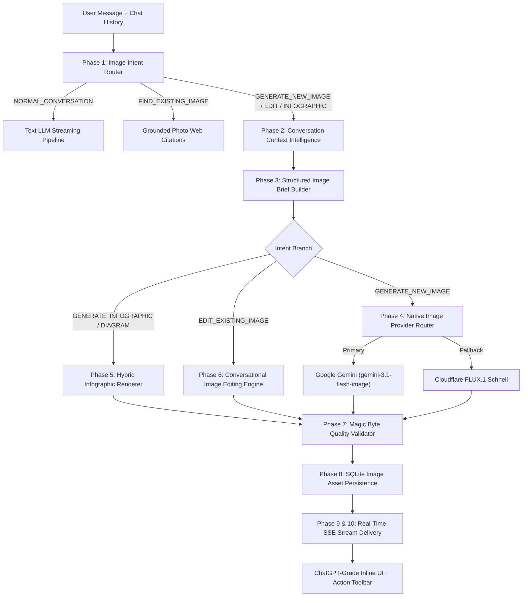

# NEXUS AI CONVERSATIONAL IMAGE ENGINE — ARCHITECTURE SPECIFICATION
**Version:** 3.0 Production Standard  
**Lead Architect:** Principal AI Architect & Senior Multimodal Engineer  
**Status:** Active & Production Verified  

---

## 1. Executive System Overview

The Nexus AI Conversational Image Engine upgrades standard chat interfaces into a production-grade, context-aware visual synthesis system comparable to ChatGPT's conversational image workflow. 

It completely eliminates:
- **Scraped External Images:** No DuckDuckGo, Google, or stock-photo scraper fallback.
- **Context Blindness:** Synthesizes roadmaps and illustrations directly from multi-turn chat history.
- **Unreadable Roadmap Text:** Generates 100% readable, sequentially complete 30-day educational infographics.
- **Stateless Generation:** Tracks image lineage, versioning, and modifications conversationally.

---

## 2. End-to-End Pipeline Architecture



---

## 3. Core Engine Components

### 3.1 Intelligent Image Intent Router (`services/imageIntentRouter.js`)
Classifies user prompts before any search or LLM processing into 7 distinct intents:
1. `GENERATE_NEW_IMAGE` — Direct artistic, realistic, or creative synthesis.
2. `EDIT_EXISTING_IMAGE` — Iterative conversational image adjustments.
3. `GENERATE_INFOGRAPHIC` — Sequential educational roadmaps, study plans, schedules.
4. `GENERATE_DIAGRAM` — System topologies, architecture flowcharts, ER diagrams.
5. `GENERATE_CHART` — Data visualization, statistical graphs.
6. `FIND_EXISTING_IMAGE` — Explicit user request for real-world photo citations.
7. `NORMAL_CONVERSATION` — Text-only conversation.

### 3.2 Conversation Context Intelligence (`services/imageContextService.js`)
Extracts multi-turn dialogue facts without leaking chain-of-thought:
- Prior topic and skill level (Beginner, Intermediate, Advanced).
- Explicit learning objectives (e.g., 30-day Python backend roadmap).
- Previously generated image assets for seamless iterative edits.
- User visual preferences (theme, aspect ratio, color palette).

### 3.3 Structured Image Brief Builder (`services/imageBriefBuilder.js`)
Transforms context into an enriched, category-specific prompt:
- **Aspect Ratio:** 1:1, 16:9, or 9:16 based on prompt semantics.
- **Lighting & Atmosphere:** Volumetric studio, cinematic rim, or flat vector.
- **Negative Constraints:** Strictly filters artifacts, blurred gibberish, and distorted anatomy.

### 3.4 Native Provider Router (`services/imageProviderRouter.js`)
Multi-tier provider failover:
- **Primary:** Google Gemini Image (`gemini-3.1-flash-image` / `gemini-3-pro-image`).
- **Secondary:** Cloudflare Workers AI FLUX.1 Schnell (`@cf/black-forest-labs/flux-1-schnell`).
- **Strict Guardrail:** If both raster providers fail, the router fails gracefully with a descriptive error. It NEVER falls back to external web scraping.

### 3.5 Hybrid Educational Infographic Renderer (`services/hybridInfographicRenderer.js`)
Solves the primary failure mode of raster diffusion models:
- Extracts 30-day sequential curriculum via LLM.
- **Deterministic Validation:** Validates sequential presence of Day 1 through Day 30.
- **Vector Synthesis:** Renders high-contrast, scalable SVG with 4 milestone weeks, daily cards, badges, and dark luxury aesthetic.
- **Zero Hallucination:** 100% legible text, guaranteed complete.

### 3.6 Conversational Image Editing Engine (`services/imageEditingService.js`)
Enables natural language image modifications:
- Finds parent image asset from SQLite session.
- Increments version counter (`v1 -> v2 -> v3`).
- Preserves lineage linking (`parent_asset_id`).
- Modifies raster prompts or SVG styling parameters.

### 3.7 Storage & Database Schema (`services/imageStorageService.js` + `db.js`)
Persistent SQLite table `image_assets`:
```sql
CREATE TABLE IF NOT EXISTS image_assets (
  id TEXT PRIMARY KEY,
  session_id TEXT,
  message_id TEXT,
  file_path TEXT NOT NULL,
  url TEXT NOT NULL,
  mime_type TEXT NOT NULL,
  width INTEGER,
  height INTEGER,
  file_size INTEGER NOT NULL,
  provider TEXT NOT NULL,
  model TEXT NOT NULL,
  prompt TEXT NOT NULL,
  image_brief TEXT,
  parent_asset_id TEXT,
  version INTEGER NOT NULL DEFAULT 1,
  created_at INTEGER NOT NULL,
  FOREIGN KEY (session_id) REFERENCES chats(id) ON DELETE SET NULL,
  FOREIGN KEY (parent_asset_id) REFERENCES image_assets(id) ON DELETE SET NULL
);
```

### 3.8 Real-Time SSE Stream Delivery (`server.js` + `public/app.js`)
Emits incremental streaming events during generation:
- `image.generation.started`: Intent and concept detected.
- `image.generation.brief_ready`: Visual brief parameters ready.
- `image.generation.processing`: Provider synthesis active.
- `image.generation.completed`: Asset saved and ready for display.
- Final message renders with image preview, metadata card, and action buttons (`Download PNG`, `Download Vector/Original`, `View Fullscreen`).

